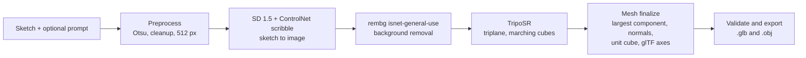

# Sketch2Shape AI

Draw or upload a rough sketch, add an optional text prompt, and get a textured 3D mesh as `.glb` or `.obj`. Built for TechZephyr 4.0 at IIT Bhubaneswar, a 24 hour hackathon.

The organisers asked for a localhost run plus a 2 to 3 minute demo video, so there is no hosted demo. You run the server on your own machine and open it in a browser.

## How it works



| Stage | What it does |
| --- | --- |
| Preprocess | Thresholds the sketch with Otsu, removes specks and resizes to 512 px. |
| Generate | Stable Diffusion 1.5 with a ControlNet scribble model turns the sketch and prompt into a clean object image. The outline of the sketch stays. |
| Cutout | rembg with the `isnet-general-use` model removes the background. |
| Reconstruct | TripoSR predicts a triplane from the image. We sample its density on a grid and run scikit-image marching cubes. The grid is 256 on a GPU and 192 on CPU. |
| Finalize | Keeps the largest connected component, merges duplicate vertices, rotates to glTF axes (Y up, front on +Z) and fits the mesh in a unit cube. |
| Export | Writes `result.glb` and `result.obj` with vertex colours, then checks that the file loads and is real geometry. |

Every machine runs the same models with the same default settings. Only the device changes, `cuda` on an NVIDIA GPU and `cpu` everywhere else. A CPU run takes longer and the app says so.

## Three ways in

1. Local, with an NVIDIA GPU. Fastest. The reconstruct stage fits in 4 GB of VRAM (2.4 GB peak, `EXPERIMENTS.md` row 4). The generate stage needs more, see "Limitations".
2. Local, on CPU. Works on any laptop and takes longer. TripoSR alone takes 22 to 33 s on the CPUs we tried. TODO add the full pipeline time on CPU once measured.
3. The demo video. TODO link.

## Requirements

- Linux, macOS or Windows.
- `git` and `uv`. The setup script checks for both and installs nothing silently. `uv` installs Python 3.11.
- About 7 GB of disk for model weights, plus the Python environment.
- 16 GB of RAM is comfortable on CPU. TripoSR at grid 192 used 5.6 GB (`EXPERIMENTS.md` row 1).
- Optional NVIDIA GPU with current drivers.

## Install

```
git clone https://github.com/Swayam2004/sketch2shape-techzephyr.git
cd sketch2shape-techzephyr
scripts/setup.sh                              # Linux and macOS
# scripts/setup.ps1                           # Windows, PowerShell
uv run python scripts/download_weights.py     # about 7 GB, no Hugging Face token needed
```

The setup script prints which hardware tier your machine falls in. Windows users with an NVIDIA card need a CUDA build of PyTorch, because the default Windows wheel is CPU only.

If a download times out, set `UV_HTTP_TIMEOUT=300` and run it again. The weight script skips files it already has.

## Run

Start the server and open the dashboard.

```
uv run sketch2shape serve
```

Then open http://localhost:7860. The default port is 7860, change it with `--port`.

Or run one sketch from the command line.

```
uv run sketch2shape generate samples/sketches/01_chair.png --prompt "a wooden chair" --seed 0 --out outputs/
```

The log prints the device, the seconds per stage and the silhouette IoU.

If you set `S2S_ACCESS_CODE` in `.env`, the dashboard asks for that code. Leave it empty to run without one.

## Inputs and outputs

| | |
| --- | --- |
| Sketch | PNG, JPG or WebP, up to 10 MB. Dark strokes on a white background work best. Transparent PNGs are fine. |
| Prompt | Optional, up to 300 characters. |
| Seed | Integer, default 0. We log it with every output. |
| Output | `result.glb`, `result.obj` and the generated image. The CLI writes them to `outputs/`. The server keeps them for one hour per job. |

The mesh carries vertex colours, not a baked texture. We left the upstream texture bake out on purpose, because its open bugs produce GLB files Blender cannot open.

## Open the result in Blender

File, Import, glTF 2.0 (`.glb`). Switch the viewport shading to Vertex Color, or add a Color Attribute node in the material, to see the colours. TODO add the add-on install steps once `blender_addon/` lands.

## Results

TODO a sample sketch, the generated image, a render of the mesh and a link to `samples/`.

## Timing and hardware

| Run | Machine | Seconds | Memory |
| --- | --- | --- | --- |
| TripoSR, grid 192, CPU | M2 MacBook Air | 32.9 | 5.6 GB RAM |
| TripoSR, grid 192, CPU | Linux laptop | 22.5 | not measured |
| TripoSR, grid 256, GPU | GTX 1650 Ti, 4 GB | 5.4 | 2370 MB VRAM |
| Full pipeline, GPU, stubbed sketch stages | GTX 1650 Ti | about 14 cold, 6.6 warm | 2370 MB VRAM |

Source is `EXPERIMENTS.md`. TODO add rows for the generate stage on the RunPod GPU and on CPU.

## Models and third-party components

All weights download by script into `weights/` (gitignored). None are gated.

| Component | Source | Licence | Used for |
| --- | --- | --- | --- |
| TripoSR | `stabilityai/TripoSR`, code from VAST-AI-Research/TripoSR | MIT | Image to 3D |
| Stable Diffusion 1.5 | `stable-diffusion-v1-5/stable-diffusion-v1-5` | CreativeML Open RAIL-M | Sketch to image |
| ControlNet scribble v1.1 | `lllyasviel/control_v11p_sd15_scribble` | OpenRAIL | Keeps the sketch outline |
| rembg, `isnet-general-use` | danielgatis/rembg | MIT (library), model terms TODO | Background removal |
| `tsr` (vendored) | VAST-AI-Research/TripoSR at commit `107cefd`, changes in `src/sketch2shape/vendor/tsr/SOURCE.md` | MIT | TripoSR model code |
| model-viewer 4.4.0 | Google, `@google/model-viewer`, copy in `src/sketch2shape/api/static/` (file header says BSD-3-Clause, the npm package says Apache-2.0) | BSD-3-Clause or Apache-2.0 | 3D view in the dashboard, works offline |

TODO add the remaining libraries (trimesh, scikit-image, diffusers, FastAPI and the rest).

Our inputs are pretrained models and our own sketches in `samples/sketches/`. We trained nothing.

## Limitations

- A single view hides the back of the object, so TripoSR guesses it. Expect plausible but invented backs.
- The generate stage does not run on a 4 GB laptop GPU. fp16 returns a black frame and fp32 runs out of memory (`EXPERIMENTS.md` row 7). Use a GPU with more memory or the CPU path.
- Meshes are not always watertight. The CPU default of grid 192 gave a non-watertight chair, grid 256 gave a watertight one.
- Sketches with several objects or heavy shading give poor results. TODO add the failure cases from the test set.

## Troubleshooting

| Symptom | Cause and fix |
| --- | --- |
| Black generated image on a small GPU | fp16 overflow on a 4 GB card. Run with `--device cpu`, or use a bigger GPU. |
| CUDA out of memory in the generate stage | The model needs more than 4 GB. Use `--device cpu`. |
| The run is slow and the log says `cpu` | No NVIDIA GPU was found. This is expected. TripoSR grid 192 takes 22 to 33 s, the generate stage takes minutes. |
| The 3D view stays empty | The viewer script ships in the repo, so this is not a network problem. Check the browser console. Download the `.glb` and open it in Blender meanwhile. |
| `uv sync` times out | Set `UV_HTTP_TIMEOUT=300` and rerun. |

## What did not work

See `EXPERIMENTS.md`. TODO a short summary.

## AI tool usage

See `AI_USAGE.md`.

## Team

Himansu Swayam, Dishashree Swain and Udit Arun Nath.
