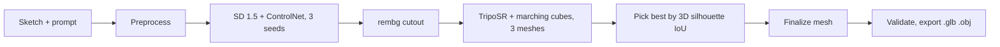

# Sketch2Shape AI (2DorNot2D): project report

Team TechZephyr 4.0, IIT Bhubaneswar, 24 hour hackathon, 31 Oct 12:00 to 1 Nov 12:00 IST. Swayam built the pipeline, API and GPU runs. Disha built the dashboard, the test sketches and the docs. Udit built the sketch and generation stages, the scorer and the Blender add-on.

Every number below comes from `EXPERIMENTS.md`, `README.md` or the files in `samples/`. Where a number is an estimate or a proposal, the text says so.

## 1. The problem

A 3D modeller needs hours to turn a rough drawing into an asset. The hackathon brief asks for a tool where a person draws or uploads a sketch, optionally types a short prompt, and receives a textured 3D model as `.glb` or `.obj`.

Three rules from the brief shape everything.

- The output must be real geometry that opens in Blender. A rendered image, a screenshot or a flat textured plane scores nothing.
- Judges run the project themselves, possibly on a laptop with no NVIDIA card, so results must match across machines.
- Teams report generation time, hardware and limitations. The hidden side of the object only has to be plausible, not exact.

The rubric has five parts: technical implementation 25, 3D output quality 25, pipeline validity and efficiency 20, reproducibility 15, documentation 15.

## 2. Our solution

A sketch looks too unlike the images that 3D models learn from, so we put a picture in the middle. A diffusion model first turns the sketch into a clean product-style image that keeps the sketch outline. A second model lifts that image to a 3D mesh.

You draw a chair, type "a wooden chair" and press one button. About 16 seconds later on a GPU, the page shows a spinning mesh with vertex colours that you can download as `.glb`, `.obj` or `.png`. The same run works on a laptop CPU. It takes minutes instead of seconds.

### Highlights

- **One pipeline on every machine.** The same models and settings run on an NVIDIA GPU or on CPU. Only the device changes, so a judge without a GPU still reproduces the result.
- **A fidelity number.** Silhouette IoU compares the mesh's front outline with the cleaned sketch. We use it to score every run and to choose between candidates.
- **Best of 3 by the 3D outline.** The pipeline tries three seeds, builds all three meshes and keeps the one that matches the sketch best. This took the mean IoU on 12 real sketches from 0.880 (one seed) to 0.911.
- **No gated models, no tokens.** Every weight downloads by script with no Hugging Face login.
- **Real geometry, checked.** The export step reloads the saved file, checks that it has faces and vertex colours, and reports whether the mesh is watertight.
- **Three ways to use it.** A browser dashboard, a command line tool, and a Blender add-on that sends a sketch to the local server and imports the result.
- **Honest records.** 17 logged experiments after the repo was created, failures included, and 86 passing tests.

## 3. Tech stack

| Layer | What we used |
| --- | --- |
| Language and tooling | Python 3.11, `uv` for locked installs, `pytest`, `ruff` |
| Sketch to image | Stable Diffusion 1.5 with ControlNet scribble v1.1, through `diffusers` |
| Background removal | `rembg` with the `isnet-general-use` model |
| Image to 3D | TripoSR, vendored into the repo (MIT) |
| Mesh extraction | scikit-image marching cubes, `trimesh` for cleanup and export |
| Scoring | OpenCV for the orthographic silhouette, NumPy |
| Backend | FastAPI and uvicorn, one worker, job queue with polling |
| Dashboard | Plain HTML, CSS and JS modules, three.js r160 (vendored, works offline), IndexedDB for history |
| Blender | A Python add-on that talks to the local server |
| GPU for development | Rented RunPod RTX PRO 4500 (32 GB) at $0.72 an hour, plus a GTX 1650 Ti laptop |

We vendored TripoSR instead of installing it. Upstream needs `torchmcubes`, which has no wheels, and its texture bake has open bugs.

## 4. Architecture and workflow

| Stage | What happens |
| --- | --- |
| Preprocess | Otsu threshold, speck removal, 512 px canvas. Produces a clean sketch, a filled mask and a scribble map. |
| Generate | SD 1.5 with the ControlNet scribble branch makes an object image for each of three seeds. |
| Cutout | rembg removes the background from each image. |
| Reconstruct | TripoSR predicts a triplane from the image. We sample its density on a 256 grid on GPU or 192 on CPU and run marching cubes. |
| Select | The pipeline scores each mesh outline against the sketch mask and keeps the best. |
| Finalize | Keep the largest connected piece, merge duplicate vertices, rotate to glTF axes (Y up, front on +Z), fit a unit cube. |
| Export | Write `.glb` and `.obj`, reload the file, check it is real geometry. |

How the pieces connect.

- Stage inputs and outputs are fixed in `types.py`, and the HTTP contract is in `docs/api.md`. That let three people build in parallel without waiting for each other.
- The server loads TripoSR and rembg at startup. With the sketch stages stubbed, a job on the 4 GB laptop took 6.6 s instead of about 14 s with a cold load.
- Proxies cut long requests at 100 seconds and a CPU run takes minutes, so the client submits a job and polls. It polls every second for 10 seconds, then every 3, and stops after 15 minutes.
- The queue holds 5 waiting jobs and returns 429 beyond that. Files are deleted an hour after a job ends.
- The dashboard shows progress for each stage, a live 3D view, four view modes, a history of earlier designs kept only in the browser, four brush types and four stroke weights.

How the team worked. Three laptops (Linux, Mac, Windows) and one rented GPU. Every change went through a pull request that Swayam merged, every session started with a sync check, and every AI tool use is logged in `AI_USAGE.md`. The repo has 34 commits on `main` and 31 pull requests.

## 5. Results

Twelve pen sketches photographed on paper, each with one prompt, seed 0, RTX PRO 4500.

| Selection method | Mean silhouette IoU | Lowest | Seconds per sketch, warm |
| --- | --- | --- | --- |
| One seed | 0.880 | 0.683 (bulb) | 5 |
| Best of 3 by the 2D cutout | 0.893 | 0.701 (bulb) | 12 |
| Best of 3 by the 3D mesh (default) | 0.911 | 0.701 (bulb) | about 16, estimated |

All 12 sketches produced a mesh. The best results were the bottle (0.961), donut (0.970) and ice cream (0.951). On a separate set of 18 synthetic cases, best of 3 by the 2D cutout raised the mean from 0.809 to 0.851. It fixed the worst failure, a chair sketch prompted as "a horse", from 0.384 to 0.937.

Prompts steer material and style (red velvet, gingerbread, steampunk, glass). When prompt and sketch disagree, the sketch wins. "A porcelain teapot" on a mug sketch still gives a mug.

## 6. Challenges we hit

| Challenge | What we did |
| --- | --- |
| The TripoSR checkpoint failed to load under transformers 5, which renamed the ViT layers. | We rename the checkpoint keys while loading and kept the new library. |
| The first marching cubes swap made triangles that face inward. | A sphere test caught it. `gradient_direction="descent"` fixed it. |
| TripoSR's frame is Z up with the front on +X, so meshes came out rotated. | We found it by rendering from three sides and rotate to glTF axes in `finalize_mesh`. |
| The generate stage does not fit a 4 GB card. fp16 gave a black frame and the fp32 retry ran out of memory. | Udit's fix frees the fp16 pipeline before the retry and keeps the VAE in fp32. Generation runs on larger GPUs. |
| TripoSR needed about 6 GB by default. | Chunked density queries cut it to 2.4 GB, so the 3D step fits the 4 GB laptop. |
| A white object on a light background defeats rembg. | Best of 3 gives the pipeline another chance, which fixed the horse case. |
| Choosing a candidate by its 2D cutout sometimes picked a worse mesh (cloud 0.972 down to 0.883). | We now build all three meshes and choose by the 3D outline. |
| Prompt, ControlNet scale, background colour and foreground ratio tweaks helped one case and hurt another. | We kept the defaults and logged the tests (`EXPERIMENTS.md` row 15). |
| A hosted demo seemed necessary, then the organisers said a localhost run and a video are enough. | We dropped hosting (decision D25) and spent the time on quality and the dashboard. |

Weak spots that remain. The bulb sketch has light rays that leak into the mask and gives a blob (0.701). The button sketch has four holes and the result has five. The cloud is flat when seen from the side. The back of every object is a guess, because TripoSR sees one view.

## 7. Existing models and why we chose ours

| Model | Strength | Why we did not use it as the main path |
| --- | --- | --- |
| TripoSR (our choice) | MIT licence, no gating, runs on CPU and GPU, 3D step in seconds | Quality is a tier below the newest models and the back side is a guess. |
| Hunyuan3D 2 and 2.1 | Highest quality of the candidates, UV textures | Needs a compiled CUDA extension, Python 3.10 and a large GPU (about 16 GB, 29 GB for 2.1). No CPU path. The licence excludes the EU, UK and South Korea. |
| TripoSG and TripoSG-scribble | Direct sketch input, MIT | Shape only, compiled CUDA package, more than 8 GB of VRAM. |
| Stable Fast 3D, TRELLIS | Fast or strong on some inputs | Left out for install difficulty (see `docs/research/model-quality.md`). |
| Sketch research (SketchDream, Sketch2Model, SKED) | Built for sketches | We read them for ideas and for the fidelity metric (`docs/research/papers-review.md`) and did not run them. |

We picked the model that every judge can run, not the one with the best single result. Reproducibility is 15 points and a pipeline that fails on a judge's laptop scores zero on the rest.

## 8. GPU usage and requirements

| Run | Machine | Time | Memory |
| --- | --- | --- | --- |
| TripoSR only, grid 256, GPU | GTX 1650 Ti, 4 GB | 5.4 s | 2370 MB VRAM |
| TripoSR only, grid 192, CPU | M2 MacBook Air | 32.9 s | 5.6 GB RAM |
| TripoSR only, grid 192, CPU | Linux laptop | 22.5 s | not measured |
| Full pipeline, one seed, warm | RTX PRO 4500, 32 GB | 5 s | 5.5 GB in generate |
| Full pipeline, best of 3, warm | RTX PRO 4500, 32 GB | about 16 s (estimate) | 5.5 GB in generate |
| Full pipeline, one seed, CPU | Ryzen 7 PRO 7840U, 16 GB | 306 s | 7.2 GB RAM |

What a user needs.

- **Disk.** About 7 GB for weights, plus the Python environment.
- **GPU path.** An NVIDIA card. Generation peaked at 5.5 GB on the rented card. We have not tested cards between 4 GB and 32 GB, so 8 GB or more is our expectation, not a measurement.
- **CPU path.** 16 GB of RAM is comfortable. Best of 3 takes about 15 minutes. The dashboard shows a warning.
- **Cold start.** The first run loads models for 3 to 7 minutes. After that each job is fast.
- **Cost of our own testing.** One RunPod card at $0.72 an hour. At 16 s per sketch, the GPU time is about $0.003 per sketch, before idle time and cold starts.

## 9. Future scope

- **Multi-view models.** Zero123++ or InstantMesh would give the model a view of the back, which fixes the flat clouds and guessed backs. This is the largest quality gain available.
- **Texture bake.** Replace vertex colours with a UV texture once a bake is shown to open cleanly in Blender (decision D24).
- **A higher quality tier.** Offer Hunyuan3D as an option on large GPUs while keeping TripoSR as the default everyone can run.
- **Smaller GPUs.** Make the generate stage fit 4 GB with offloading, which is already written but untested on a CUDA card.
- **Cleaner sketches.** Remove stray marks such as the bulb's rays before building the mask, and handle several objects in one sketch.
- **Blender check.** Test the add-on's Generate button inside Blender. Only a headless import has been tried so far.
- **Hosting.** A cloud version for people without a GPU (below).

## 10. Proposed business model and USP

The repo has no business plan. This section is a proposal for the team to confirm, built on the costs we measured.

**Who would pay.**
- Indie game developers and hobbyists who want quick prop blockouts.
- Teachers and students who want to see a drawing in 3D.
- Product designers who prototype shapes before a CAD pass.
- People who send models to a 3D printer.

**Model.**
1. A free open-source local app, which is what we built. It builds trust and a user base.
2. A hosted tier with monthly credits for people without a GPU. The cost to us is small, about $0.003 of GPU time per warm sketch at our rented rate. Scale-to-zero hosting avoids paying for idle cards.
3. A Pro plan with batch jobs, an API key, the Blender add-on and higher-quality models such as Hunyuan3D.
4. School and studio licences with shared history and bulk credits.

We have not set prices. They should sit well above the compute cost and below an hour of freelance modelling, and the team should test them with real users.

**Licence risks to clear before selling.** Stable Diffusion 1.5 uses the CreativeML Open RAIL-M licence, which allows commercial use with usage restrictions. The rembg `isnet-general-use` model terms are still marked "to confirm" in the README. Hunyuan3D's licence excludes some regions.

**Unique selling points.**
- It runs on a laptop, with or without a GPU, and gives the same result on both.
- It needs no account, no token and no upload. A sketch never leaves the user's machine.
- It measures how closely the 3D shape follows the sketch and uses that to pick the best of three, so it targets fidelity to the drawing, not only a good-looking model.
- It exports real geometry that opens in Blender, with an add-on to send sketches from inside it.
- Every step, failure and AI tool use is documented, so a result can be reproduced.

## 11. Limits and open items

- Meshes carry vertex colours, not a texture.
- The back of the object is invented.
- The meshes have not yet been opened and checked in the Blender window.
- The 3D-selection timing of about 16 s is an estimate. `EXPERIMENTS.md` row 17 says it was not re-measured.
- All GPU quality numbers come from one rented RTX PRO 4500. The CPU path was timed on one Windows laptop with a single seed.
- The demo video is not recorded.
