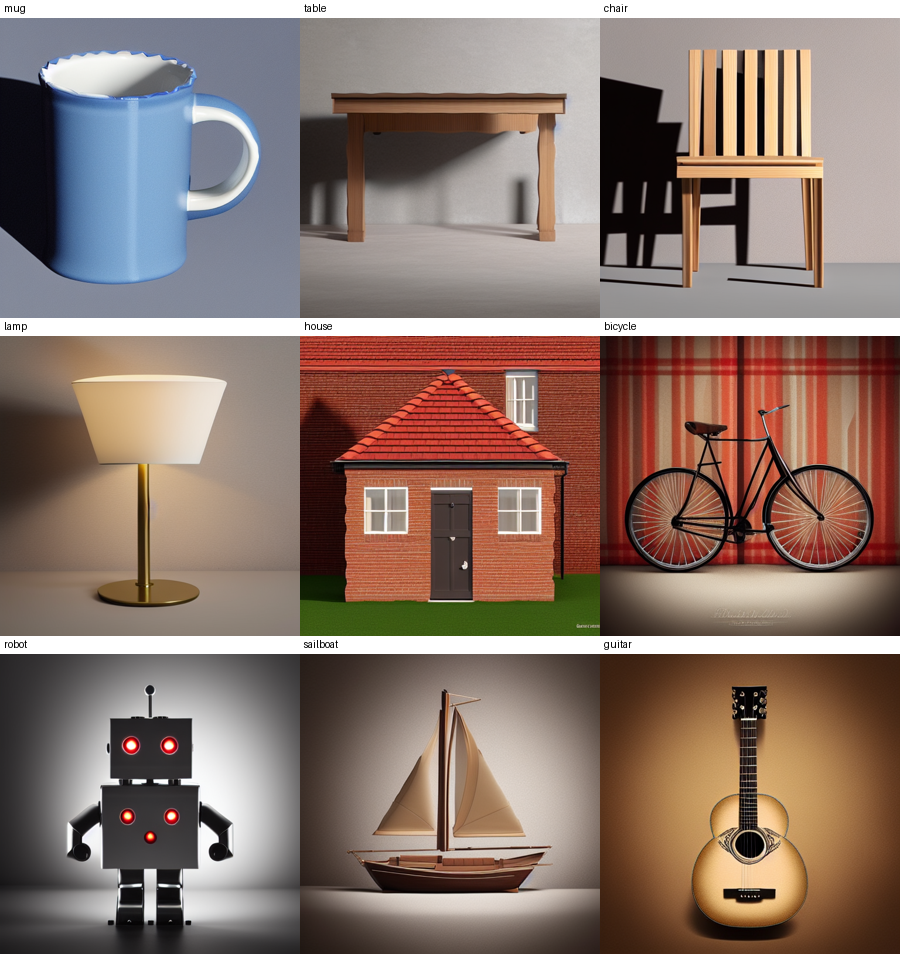
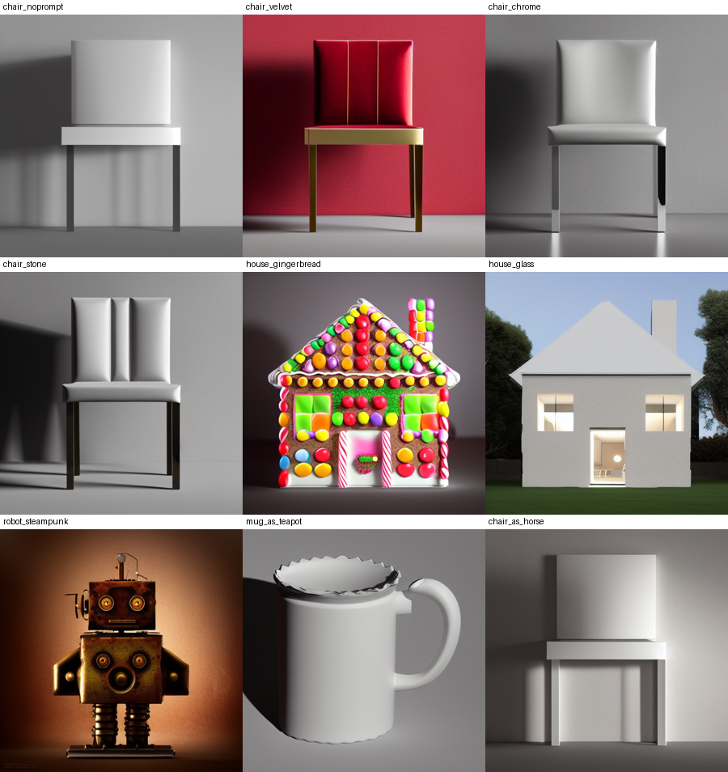

# Test case results

Run on 1 Nov 2026, RunPod RTX PRO 4500 Blackwell (32 GB), seed 0, fp16, grid 256, one process. The first case includes about 6.5 minutes of cold model loading. Every other case took 5 to 6 s warm (10.3 s for the gingerbread house, which has 289,308 faces). No case failed and no case needed the fp32 retry.

Inputs are in `samples/test_cases/`. Rerun with `uv run python samples/test_cases/run_cases.py`.

| Case | Level | Prompt | IoU | Seconds | Faces | Watertight | Warnings |
| --- | --- | --- | --- | --- | --- | --- | --- |
| mug | 1 simple | a blue ceramic mug | 0.733 | 407.1 | 158438 | True | - |
| table | 1 simple | a wooden dining table | 0.627 | 5.3 | 55488 | True | - |
| chair | 2 medium | a wooden chair | 0.945 | 5.7 | 121250 | True | - |
| lamp | 2 medium | a brass desk lamp with a white shade | 0.708 | 5.6 | 68632 | True | - |
| house | 3 detailed | a small red brick cottage | 0.931 | 6.4 | 226154 | True | - |
| bicycle | 3 detailed | a vintage bicycle | 0.750 | 5.1 | 61200 | True | - |
| robot | 3 detailed | a friendly toy robot, shiny metal | 0.864 | 5.3 | 92420 | True | - |
| sailboat | 4 complex | a wooden sailboat | 0.712 | 5.1 | 61840 | True | - |
| guitar | 4 complex | an acoustic guitar | 0.896 | 5.1 | 59592 | True | - |
| chair_noprompt | prompt test: none | (none) | 0.918 | 5.2 | 70716 | True | - |
| chair_velvet | prompt test: material | a red velvet armchair | 0.877 | 5.4 | 88204 | True | - |
| chair_chrome | prompt test: style | a futuristic chrome chair | 0.903 | 5.3 | 74098 | True | - |
| chair_stone | prompt test: material | a chair carved from grey stone | 0.923 | 5.2 | 73688 | True | - |
| house_gingerbread | prompt test: style | a gingerbread house covered in candy | 0.917 | 10.3 | 289308 | True | - |
| house_glass | prompt test: style | a modern glass and concrete house | 0.949 | 5.6 | 151998 | True | - |
| robot_steampunk | prompt test: style | a rusty steampunk robot with brass gears | 0.785 | 5.9 | 109464 | True | - |
| mug_as_teapot | prompt test: conflicts with sketch | a porcelain teapot | 0.738 | 6.0 | 128176 | True | - |
| chair_as_horse | prompt test: conflicts with sketch | a horse | 0.384 | 6.4 | 165514 | True | - |

## What the numbers and images show

- IoU does not fall as sketches get harder. Mean IoU is 0.680 at level 1, 0.827 at level 2, 0.848 at level 3 and 0.804 at level 4. The low scores come from the generator redrawing the shape (table 0.627, lamp 0.708, sailboat 0.712), not from complexity.
- The prompt steers material and style. A red velvet armchair, a gingerbread house, a steampunk robot and a glass house all look right. IoU stays between 0.785 and 0.949 for these.
- Material words are not always followed. "A chair carved from grey stone" gives a grey padded chair.
- The sketch beats the prompt when they disagree. "A porcelain teapot" on the mug sketch still gives a mug (0.738 against 0.733 without the prompt). "A horse" on the chair sketch gives a plain table-like object, and IoU drops to 0.384 because rembg loses a white object on a light grey background.
- The mug image is zoomed in and cropped at the rim. The sketch fills the frame and the model does not shrink it.
- TripoSR guesses depth from one view. The guitar has depth 0.90 of its width and the steampunk robot 1.11, which is thicker than real ones.
- Every mesh is one watertight component with vertex colours.
